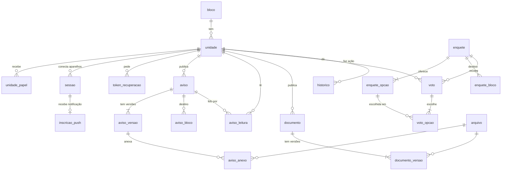

# 04 · Modelo de dados — Entrega 1

| | |
|---|---|
| **Status** | v0.3 — M4 em andamento (enquetes, migração 0008 no contrato) |
| **Autor** | Erick Santos Dantas |
| **Criado em** | 02/10/2026 |
| **Base** | `03-historias.md` v0.1 (somente E1) |
| **Próximo documento** | `05-arquitetura.md` + ADRs |

---

## 1. Premissas

- Banco **relacional (PostgreSQL)**. A escolha formal e a hospedagem ficam num ADR do documento
  de arquitetura. Aqui, os tipos já são os do Postgres.
- **Chaves:** `bigint` gerado pelo banco (`generated always as identity`). Segredos (sessão,
  recuperação de senha) são tokens aleatórios guardados **só como hash**.
- **Datas:** sempre `timestamptz` (com fuso). O banco guarda em UTC e a tela mostra no horário
  de Recife (`America/Recife`).
- **Arquivos** (PDFs, imagens) ficam num serviço de armazenamento, **fora do banco** (RNF-22).
  O banco guarda só os metadados e a chave do arquivo.
- **Nomes** em português, minúsculos, no singular (`unidade`, `aviso`), como no restante dos
  documentos.
- Só entra aqui o que a **E1** precisa. Reservas, chamados e o resto ganham tabelas quando a
  entrega deles começar. Até lá, o modelo não deve ser adivinhado.

## 2. Diagrama

## 3. Tabelas

### 3.1 Unidades e acesso

**`bloco`** — os 5 blocos (H-10)

| Coluna | Tipo | Regra |
|---|---|---|
| `id` | bigint | PK |
| `numero` | smallint | único, 1–9. É o primeiro dígito do login. |
| `nome` | text | ex.: "Bloco 3" |
| `ativo` | boolean | padrão `true`. Bloco não é apagado, só desativado. |

**`unidade`** — uma linha por apartamento **e** a conta de acesso dele (RF-01, RF-03)

| Coluna | Tipo | Regra |
|---|---|---|
| `id` | bigint | PK |
| `bloco_id` | bigint | FK `bloco` |
| `numero` | text | 3 dígitos, ex.: `'502'`, `'007'`. Único dentro do bloco. |
| `andar` | smallint | 0 = térreo … 7 |
| `login` | text | **único**. `bloco.numero` + `numero`, ex.: `'1101'`. Gerado pelo banco. |
| `ativa` | boolean | padrão `true`. Desativar em vez de apagar (H-10). |
| `senha_hash` | text | hash **Argon2id**. Nunca a senha. |
| `precisa_trocar_senha` | boolean | `true` enquanto estiver com `mudar123` (H-01) |
| `ativada_em` | timestamptz | nulo = "não ativada". Preenchido ao concluir o 1º acesso. |
| `responsavel_nome` | text | **dado pessoal** · obrigatório após ativar |
| `celular` | text | **dado pessoal** · obrigatório após ativar |
| `email` | text | **dado pessoal** · opcional |
| `receber_avisos_email` | boolean | padrão `true` (migração 0006). `false` = não manda cópia dos avisos por e-mail; o e-mail continua valendo para o "esqueci a senha". "Apagar meus dados" volta para `true`. |
| `tentativas_falhas` | smallint | zera no login certo (H-03) |
| `bloqueada_ate` | timestamptz | nulo = livre |

> **Por que a conta mora na própria `unidade`:** a decisão de 02/10/2026 é "uma conta por
> unidade". Uma tabela `usuario` separada só existiria para permitir várias contas por unidade,
> o que foi descartado. Se um dia mudar, a migração é criar `usuario` e mover estas colunas.

**`unidade_papel`** — quem tem poder de gestão (RF-09, H-09)

| Coluna | Tipo | Regra |
|---|---|---|
| `id` | bigint | PK |
| `unidade_id` | bigint | FK `unidade` |
| `papel` | enum `papel` | `admin`, `comissao`, `sindico`, `conselho` |
| `concedido_em` / `concedido_por` | timestamptz / FK `unidade` | |
| `retirado_em` / `retirado_por` | timestamptz / FK `unidade` | nulo = papel em vigor |

Papel não é apagado ao ser retirado: a linha recebe `retirado_em`. Assim se sabe quem foi da
Comissão e quando. Restrição: **um papel em vigor por tipo por unidade** (índice único parcial
`where retirado_em is null`).

**`sessao`** — cada aparelho conectado (H-02, H-06)

| Coluna | Tipo | Regra |
|---|---|---|
| `id` | bigint | PK |
| `unidade_id` | bigint | FK `unidade` |
| `token_hash` | text | único. O aparelho guarda o token; o banco, só o hash. |
| `aparelho` | text | descrição curta tirada do navegador, ex.: "Android · Chrome" |
| `criada_em` / `ultimo_uso_em` | timestamptz | |
| `encerrada_em` | timestamptz | nulo = conectada. Sair, desconectar ou resetar preenche. |

**`inscricao_push`** — para onde mandar a notificação (H-05, H-13)

| Coluna | Tipo | Regra |
|---|---|---|
| `sessao_id` | bigint | PK e FK `sessao`. Uma por aparelho. Some quando a sessão é encerrada. |
| `endpoint`, `chave_p256dh`, `chave_auth` | text | dados do padrão Web Push |

**`token_recuperacao`** — "esqueci a senha" por e-mail (H-04)

| Coluna | Tipo | Regra |
|---|---|---|
| `id` | bigint | PK |
| `unidade_id` | bigint | FK `unidade` |
| `token_hash` | text | único |
| `expira_em` | timestamptz | 1 hora após criar |
| `usado_em` | timestamptz | nulo = ainda não usado. Uso único. |

### 3.2 Arquivos

**`arquivo`** — metadados do que foi enviado (RNF-22)

| Coluna | Tipo | Regra |
|---|---|---|
| `id` | bigint | PK |
| `chave` | text | único; 32 caracteres hexadecimais aleatórios, gerados pela API. O objeto mora em `envios/<chave>` até ser conferido e em `arquivos/<chave>` depois. **Nunca reaproveitada** (ADR-0011) |
| `nome_original` | text | 1 a 200 caracteres, sem `/`, `\` nem caractere de controle. Só um rótulo: o objeto nunca usa esse nome |
| `tipo` | text | só `application/pdf`, `image/jpeg`, `image/png`, `image/webp` (`CHECK`) |
| `finalidade` | text | `aviso` ou `documento` (`CHECK`) |
| `tamanho_bytes` | integer | de 1 byte a 20 MB, e até 10 MB quando `finalidade = 'aviso'` (`CHECK`) |
| `enviado_por` / `enviado_em` | FK `unidade` / timestamptz | carimbada pelo banco |
| `confirmado_em` | timestamptz | nulo = **pendente** (URL de envio dada, conteúdo ainda não conferido); preenchido pelo banco quando a API conferiu o conteúdo e publicou em `arquivos/` |

- **Pendente** pode ter `tipo` e `tamanho_bytes` corrigidos (o que o servidor achou no arquivo)
  e pode ser apagado (recusado, ou abandonado há mais de 1 dia).
- **Confirmado não muda nem é apagado** (trigger `arquivo_confirmado`), como o objeto travado
  no bucket.
- **Até 50 arquivos por unidade a cada 24 horas** (trigger `arquivo_limite_dia`, que trava a
  unidade para envios simultâneos contarem uns com os outros), contando os que existem e os
  recusados (`arquivo_recusado` no `historico`), cuja linha é apagada.

Migração 0007 (M3). Detalhes de cada regra: `docs/superpowers/specs/m3-contrato.md`, seção 2.

### 3.3 Avisos

**`aviso`** — o aviso em si (H-12 a H-16)

| Coluna | Tipo | Regra |
|---|---|---|
| `id` | bigint | PK |
| `publicado_por` / `publicado_em` | FK `unidade` / timestamptz | |
| `para_todos` | boolean | `false` = só os blocos em `aviso_bloco` |
| `fixado` | boolean | |
| `arquivado_em` | timestamptz | nulo = no mural |

**`aviso_versao`** — título e texto, com histórico de edição (RF-14, H-15)

| Coluna | Tipo | Regra |
|---|---|---|
| `aviso_id` + `versao` | bigint + smallint | PK composta. Versão 1 = publicação original. |
| `titulo`, `texto` | text | |
| `criada_em` / `criada_por` | timestamptz / FK `unidade` | |

A versão em vigor é a de maior número. "Editado em" aparece quando há mais de uma.

**`aviso_anexo`** — (`aviso_id`, `versao`, `arquivo_id`), PK nas três, mais `ordem` (1 a 5,
única por versão: **no máximo 5 anexos por versão**). Anexo pertence à versão, então a versão
antiga continua mostrando os anexos que tinha. O trigger confere: arquivo confirmado, de
finalidade `aviso`, nunca usado em documento nem em **outro** aviso (a correção do mesmo aviso
repete os anexos); e a versão foi criada **na mesma transação**, então uma versão publicada
nunca ganha nem perde anexo depois (RN-05).

**`aviso_bloco`** — (`aviso_id`, `bloco_id`), PK nas duas. Só usado quando `para_todos = false`.

**`aviso_leitura`** — (`aviso_id`, `unidade_id`) PK, mais `lido_em`. Primeira abertura conta
(H-16); abrir de novo não muda nada.

### 3.4 Documentos

**`documento`** (H-17, H-18)

| Coluna | Tipo | Regra |
|---|---|---|
| `id` | bigint | PK |
| `titulo` | text | 1 a 120 caracteres |
| `categoria` | text (`CHECK`) | `convencao`, `regimento`, `ata`, `contrato`, `obra`, `orientacao`, `outro` |
| `data_documento` | date | data do documento, não do envio; de 1990-01-01 a 2100-12-31 |
| `acesso` | text (`CHECK`) | `publico`, `compradores`, `gestao` (RF-31) |
| `criado_por` / `criado_em` | FK `unidade` / timestamptz | carimbada pelo banco |
| `aviso_id` | FK `aviso`, única, nula | o aviso automático de "Avisar as unidades" (RF-33); só para `publico` ou `compradores` |
| `arquivado_em` | timestamptz | nulo = na lista; arquivado não volta |

Categoria e nível são `text` com `CHECK`, não `enum`: acrescentar um valor é trocar um `CHECK`.
Todo documento tem a versão 1 no commit (trigger adiado `documento_completo`). Título,
categoria, data e acesso **não mudam**: publicou com o nível errado, arquiva e publica de novo.

**`documento_versao`** — (`documento_id`, `versao`) PK, `arquivo_id` (único), `enviada_por`,
`enviada_em`. Versões em sequência; a maior é a atual (H-19). O trigger confere que o arquivo
está confirmado, é de finalidade `documento`, não está em nenhum aviso, e que o documento não
está arquivado.

`documento.aviso_id` guarda **um** aviso: o da criação. O aviso de uma versão nova ("Documento
atualizado: …", opcional) sai sem o botão "Ver o documento", porque ligar mais avisos ao
documento pede outra coluna ou tabela (ex.: `aviso_id` em `documento_versao`); está no backlog
do roadmap. Ids de todas as tabelas são `bigint`: a API recusa com 422 qualquer id fora dessa
faixa, antes de chegar ao banco (fechamento do M3).

### 3.5 Enquetes

Migração 0008 (contrato do M4: `docs/superpowers/specs/m4-contrato.md`, seção 2).

**`enquete`** (H-20)

| Coluna | Tipo | Regra |
|---|---|---|
| `id` | bigint | PK |
| `pergunta` | text | 1 a 200 caracteres |
| `multipla_escolha` | boolean | padrão `false` (escolha única) |
| `mostrar_resultado` | text | `durante` (padrão) ou `so_no_fim` (RF-23). `text` com `CHECK`, não `enum`, como as categorias |
| `encerra_em` | timestamptz | no futuro e em até 366 dias, ao criar e ao editar (trigger); sempre depois de `criada_em` |
| `para_todos` | boolean | `false` = só os blocos em `enquete_bloco`. Não muda |
| `criada_por` / `criada_em` | FK `unidade` / timestamptz | carimbada pelo banco |
| `editada_em` | timestamptz | nula até a 1ª edição; carimbada pelo banco |
| `aviso_id` | FK `aviso` | **obrigatória e única**: o aviso automático (H-13), na mesma transação. Não muda |

Completa no commit: de 2 a 10 opções e, se não é para todos, pelo menos um bloco. Depois do 1º
voto ou do encerramento, **nada muda** (nem as opções). O `app` só altera pergunta, tipo de
escolha, "mostrar resultado" e término, e não apaga.

**`enquete_opcao`** — `id` PK, `enquete_id`, `texto` (1 a 100, único na enquete), `ordem`
(1 a 10, única na enquete). De 2 a 10 por enquete. Editar = apagar e inserir de novo, só sem voto
e com a enquete aberta.

**`enquete_bloco`** — (`enquete_id`, `bloco_id`), PK nas duas. Só na transação que cria a
enquete, e nunca numa enquete para todos.

**`voto`** — a participação da unidade (H-21)

| Coluna | Tipo | Regra |
|---|---|---|
| `enquete_id` + `unidade_id` | bigint + bigint | **PK composta → um voto por unidade (RN-01)** |
| `votado_em` | timestamptz | carimbada pelo banco; atualizada quando o voto é trocado |

Só com a enquete aberta (relógio do banco na hora da gravação) e só de unidade do destino. Sem
DELETE: o voto é trocado, nunca retirado.

**`voto_opcao`** — (`enquete_id`, `unidade_id`, `opcao_id`), PK nas três; chave estrangeira
para `voto` e para a opção **da mesma enquete**. Uma linha por opção marcada; escolha única tem
exatamente uma (conferido no commit).

Trocar o voto substitui as linhas de `voto_opcao` dentro de uma transação, depois de gravar o
`voto` com `on conflict do update` (que trava a linha: dois celulares da mesma unidade ao mesmo
tempo dão um voto só). **O conteúdo de votos anteriores não é guardado**: o que vale é o último
(H-21), e guardar escolhas antigas só criaria dado sobre o comportamento das pessoas, sem uso.

### 3.6 Histórico

**`historico`** — registro de ações, só de inclusão (RNF-14, H-11)

| Coluna | Tipo | Regra |
|---|---|---|
| `id` | bigint | PK |
| `ocorrido_em` | timestamptz | |
| `unidade_id` | FK `unidade` | quem fez. Nulo = o próprio sistema (ex.: bloqueio automático). |
| `acao` | text | ex.: `primeiro_acesso`, `reset`, `papel_concedido`, `aviso_publicado` |
| `entidade`, `entidade_id` | text, bigint | o que foi afetado, ex.: (`unidade`, 42) |
| `detalhes` | jsonb | contexto, **sem dado pessoal e sem senha** |

**`erro`** — erros da API, porque os logs da Vercel grátis duram só 1 hora (arquitetura, seção 8)

| Coluna | Tipo | Regra |
|---|---|---|
| `id` | bigint | PK |
| `ocorrido_em` | timestamptz | |
| `rota` | text | ex.: `POST /api/avisos` |
| `tipo`, `mensagem` | text | classe e mensagem da exceção, **sem dado pessoal e sem corpo da requisição** |
| `unidade_id` | FK `unidade` | quem estava logado, se houver |

Apagado automaticamente após 90 dias (é a única tabela com limpeza programada).

## 4. Onde cada regra é garantida

Regra importante não pode depender só da tela (RNF-13). Quando o banco consegue garantir, garante.

| Regra | Onde |
|---|---|
| Um voto por unidade (RN-01) | **Banco:** PK `voto (enquete_id, unidade_id)` |
| Não votar após o encerramento (H-21) | **Banco:** triggers em `voto` e `voto_opcao` comparam o relógio do banco (`clock_timestamp()`) com `encerra_em` |
| Não editar enquete depois do 1º voto (H-20) | **Banco:** triggers em `enquete` e `enquete_opcao`; a edição trava a enquete e o voto a pede `for share`, então editar e votar ao mesmo tempo não passam juntos |
| Enquete encerrada não muda (RF-25) | **Banco:** as mesmas triggers, mesmo sem voto |
| Só vota quem está no destino (e unidade ativa, desde a 0009) | **Banco** (trigger em `voto`) e **aplicação** (404 para quem não vê, com teste) |
| Voto com as opções certas | **Banco:** opção da mesma enquete (chave estrangeira composta); escolha única = uma opção (trigger no commit) |
| Nada oficial é apagado (RN-05) | **Banco:** o usuário da aplicação **não tem permissão de DELETE** em `aviso`, `aviso_versao`, `documento`, `documento_versao`, `enquete`, `enquete_bloco`, `voto`, `historico` |
| Arquivo publicado não muda nem some (ADR-0011) | **Banco:** trigger impede mudar ou apagar `arquivo` confirmado; `app` sem DELETE em `documento_versao` e `aviso_anexo`. **Bucket:** trava do R2 em `arquivos/` |
| Arquivo é mesmo PDF ou foto (RNF-22) | **Aplicação:** a API confere os primeiros bytes depois do envio e apaga o que não é |
| Documento de nível gestão só para a gestão (RF-31) | **Aplicação**, com teste (lista, documento e link dão 404 igual a inexistente) |
| Histórico não é alterado (H-11) | **Banco:** sem permissão de UPDATE e DELETE em `historico` |
| Nunca ficar sem administrador (H-09) | **Banco:** trigger impede retirar o último `admin` em vigor |
| Login único e no padrão (RF-03) | **Banco:** `login` único, gerado a partir de bloco + número |
| Senha nunca em texto (RNF-03) | **Aplicação:** Argon2id. Não existe coluna de senha em texto. |
| Votos sobrevivem ao reset (H-08) | **Aplicação:** o reset não toca em `voto` (e o banco nem deixaria apagar) |
| Permissão por papel (RNF-13) | **Aplicação**, checada no servidor em toda requisição |

## 5. Dados pessoais (LGPD)

Inventário completo da E1. Se um dado não está aqui, o sistema não guarda.

| Dado | Onde | Para quê | Quem vê | Quando some |
|---|---|---|---|---|
| Nome do responsável | `unidade.responsavel_nome` | Saber com quem falar sobre a unidade | A própria unidade e a gestão | Ao apagar dados (H-06) ou reset (H-08) |
| Celular | `unidade.celular` | Contato da gestão, confirmar dono em caso de conta tomada | A própria unidade e a gestão | Idem |
| E-mail | `unidade.email` | Recuperar senha e receber avisos (opcional) | A própria unidade e a gestão | Idem |
| Descrição do aparelho | `sessao.aparelho` | A unidade reconhecer e desconectar aparelhos | A própria unidade | Ao encerrar a sessão |
| Endereço de push | `inscricao_push` | Entregar notificação | Ninguém (uso técnico) | Ao encerrar a sessão |
| Código do IP (HMAC, não o IP) | `entrada_tentativa.ip_hash` (revisão do M1, migração 0003) | Bloquear quem tenta adivinhar a senha de uma unidade | Ninguém (uso técnico) | 15 minutos depois da última tentativa ou do fim do bloqueio |
| Nome e telefone de prestador indicado (pode ser pessoa física; Instagram opcional) | `prestador` (indicações, migração 0010) | Mostrar aos moradores logados um contato profissional indicado por vizinhos | As unidades logadas | Some da lista quando a gestão esconde o prestador (a pedido dele ou por aviso); o telefone fica guardado para ele não voltar à lista |
| Opinião sobre prestador (recomenda, comentário) e aviso à gestão | `opiniao_servico` e `aviso_servico` (indicações, migração 0010) | Ajudar os vizinhos a escolher; avisar a gestão de algo errado | A opinião: todas as unidades logadas, com a placa (bloco e apartamento) e sem o nome. O aviso: só a gestão, sem a placa | Em H-06 e H-08; a própria unidade também apaga a opinião. Escondida pela gestão, só sai em H-06 e H-08 |
| Anúncio dos classificados (tipo, título, descrição, preço) e o contato escolhido para ele (WhatsApp ou telefone) | `anuncio` (classificados, migração 0011) | Vender, trocar, doar ou procurar entre vizinhos; quem se interessa chama o dono | As unidades logadas, com a placa (bloco e apartamento) e sem o nome, enquanto o anúncio está aberto e no prazo; vencido, encerrado ou escondido, só o próprio apartamento e a gestão | Apagado de vez pela faxina diária: encerrado ou escondido pela gestão há 7 dias, vencido há 30. Também em H-06 e H-08 |
| Fotos dos anúncios (podem mostrar o interior do apartamento) | `anuncio_foto` (só a chave, o tipo e o tamanho) + bucket de arquivos, pasta `classificados/`, **sem trava e fora da cópia diária** (ADR-0012) | Mostrar o que está sendo anunciado | Quem vê o anúncio | Apagadas de verdade no bucket: ao tirar na edição, com o anúncio na faxina, em H-06 e H-08; a foto enviada e nunca usada, em 1 dia. A linha (sem o conteúdo) fica até 1 dia depois do envio, só para contar no limite do dia |
| Aviso à gestão sobre um anúncio (motivo opcional) | `aviso_anuncio` (classificados, migração 0011) | Avisar a gestão de algo errado | Só a gestão, sem a placa de quem avisou | Com o anúncio, em H-06 e H-08 |
| Documentos e anexos enviados (o conteúdo e o nome do arquivo) | `arquivo` (`nome_original`) + bucket de arquivos e a cópia cifrada (M3) | Documentos do condomínio e fotos ou PDFs dos avisos; só a gestão envia | Quem vê o documento ou o aviso (o nome da foto só a gestão) | Nunca, de propósito (ADR-0011); tirar por obrigação (ex.: LGPD) é manual: arquivar e apagar os objetos à mão |

**Não guardamos:** CPF, RG, contrato, renda, endereço IP no banco (só o código acima), localização, nem o conteúdo de
votos trocados. A foto JPEG é regravada no celular antes do envio, o que tira os metadados (EXIF),
inclusive a localização do GPS (fechamento do M3; PNG e WEBP só quando grandes). Nos
classificados, toda foto é regravada, de qualquer tipo e tamanho (revisão M1). Nas indicações,
"apagar meus dados" (H-06) e o reset (H-08) apagam as opiniões e os avisos da unidade, e o
prestador que ela indicou **fica**, mas sem o vínculo com a unidade (`prestador.criado_por` vira
nulo: o próximo morador do apartamento não herda o direito de corrigir). Nos classificados, os
dois apagam de vez os anúncios, os avisos e as fotos da unidade, inclusive no bucket; o contato
do anúncio é digitado (ou confirmado) a cada anúncio e não é o celular da unidade, que continua
visível só para a gestão. A unidade e o login (`1101`) não são dado pessoal sozinhos, porque identificam um
apartamento e não uma pessoa. Viram dado pessoal junto com o nome do responsável, por isso o nome
só aparece para a própria unidade e para a gestão.

## 6. Volume esperado

Para dimensionar o plano gratuito no documento de arquitetura.

| Tabela | Estimativa em 2 anos | Observação |
|---|---|---|
| `unidade` | 320 | fixo |
| `sessao` | ~1.000 | 2 a 3 aparelhos por unidade |
| `aviso` | ~300 | ~3 por semana |
| `aviso_leitura` | ~100 mil | 300 avisos × 320 unidades, no máximo |
| `voto` | ~15 mil | ~50 enquetes × 320 |
| `opiniao_servico` | ~3 mil | algumas centenas de prestadores, poucas opiniões cada (no máximo 30 novas por unidade a cada 24 h) |
| `anuncio` | algumas centenas ao mesmo tempo | a faxina apaga o que acabou (no máximo 10 abertos por unidade); as fotos, até 4 por anúncio, comprimidas (~300 KB cada): algumas centenas de MB no uso esperado. O teto teórico (320 unidades × 10 abertos × 4 fotos) passaria de 3 GB; o vencimento em 30 dias e a faxina seguram |
| `historico` | ~20 mil | |
| **Banco inteiro** | **< 100 MB** | folgado em qualquer plano gratuito |
| **Arquivos** | **1 a 3 GB** | PDFs da obra e imagens. **É aqui que o limite gratuito aperta**, o que justifica comprimir imagens no envio. Desde o plano B da ADR-0011, a cópia cifrada (o mesmo tamanho) também fica no R2: arquivos + cópia + dumps = 3 a 7 GB dos 10 GB. |

## 7. Carga inicial

Ao instalar, um script cria:

1. Os 5 blocos (1 a 5).
2. As 320 unidades: andares 0 a 7, posições 01 a 08 → números `001`…`008`, `101`…`108`, …,
   `701`…`708`. Todas com senha `mudar123` (já em hash), `precisa_trocar_senha = true` e
   `ativada_em` nulo.
3. O papel `admin` na unidade **1101**.

Em desenvolvimento e teste, um segundo script preenche dados **fictícios** (RNF-16): nomes
inventados, celulares `(81) 90000-0000`, e-mails em `@example.com`.
